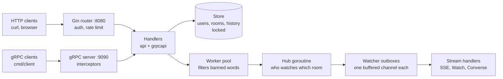

# chatserver

A multi-room chat server written in Go, with a REST API, a gRPC API, live message streaming, moderation, and load testing and profiling tools.

Users create rooms, join them and post messages. Anyone watching a room gets new messages **pushed to them the moment they're posted**, over Server-Sent Events or a gRPC stream. A pool of worker goroutines filters banned words from the live feed. It all runs in **one Go program**, in memory, with no external services.

I built it as a learning project, test-first, in six stages. Each stage introduced one area of Go: error handling, HTTP APIs with Gin, concurrency, gRPC and protobuf, content negotiation, and performance work.

---

## Contents

- [Features](#features)
- [Architecture](#architecture)
- [Project layout](#project-layout)
- [Getting started](#getting-started)
- [A quick tour](#a-quick-tour)
- [HTTP API](#http-api)
- [Live updates (SSE)](#live-updates-sse)
- [gRPC API](#grpc-api)
- [Protobuf over HTTP](#protobuf-over-http)
- [Testing](#testing)
- [Benchmarks, load testing and profiling](#benchmarks-load-testing-and-profiling)
- [Design notes](#design-notes)
- [Limitations and ideas](#limitations-and-ideas)
- [How it was built](#how-it-was-built)

---

## Features

- **REST API** with [Gin](https://github.com/gin-gonic/gin): users, rooms, membership, messages and history
- **gRPC API** on a second port, defined in [`chat.proto`](internal/pb/chat.proto), using all four kinds of call: unary, server streaming, client streaming and bidirectional
- **Live feed**: messages are pushed to watchers over Server-Sent Events (HTTP) or gRPC streams
- **Content negotiation**: the same HTTP routes speak JSON or protobuf, chosen by the `Content-Type` and `Accept` headers
- **Moderation**: a worker pool replaces messages containing banned words with `[removed]` in the live feed
- **Safe under concurrency**: every shared structure is either locked or owned by a single goroutine, verified with Go's race detector
- **Per-user rate limiting** and simple header-based authentication
- **Graceful shutdown**: in-flight requests finish, streams close and queued messages are delivered before exit
- **Built-in profiling** with `pprof`, plus a **load tester** and **benchmarks**
- **No external dependencies at runtime**: no database, no message broker

---

## Architecture



**What happens when someone posts a message:**

1. The request arrives over HTTP or gRPC. Middleware or an interceptor checks the user.
2. The handler calls the **store**, which validates the message, checks membership and adds it to the room's history.
3. The poster gets their response straight away.
4. The message is handed to the **worker pool**, which filters banned words, then to the **hub**.
5. The hub, a single goroutine that owns the map of watchers, puts a copy in every watcher's **outbox**. If an outbox is full, that watcher is dropped instead of slowing everyone else down.
6. Each watcher's own goroutine writes the message to its connection: an SSE event or a gRPC stream message.

---

## Project layout

```
chatserver/
├── go.mod
├── cmd/
│   ├── server/      # the chat server: HTTP :8080, gRPC :9090, pprof :6060
│   ├── client/      # a gRPC client for the terminal (all four kinds of call)
│   ├── protohttp/   # a demo client that talks protobuf over plain HTTP
│   └── loadtest/    # the load tester
└── internal/
    ├── chat/        # the domain: IDs, roles, messages, rooms, validation, errors
    ├── store/       # Store interface + in-memory implementation
    ├── api/         # Gin HTTP API: routes, handlers, middleware, SSE, content negotiation
    ├── grpcapi/     # gRPC server: unary and streaming calls, interceptors
    ├── pb/          # chat.proto and the code protoc generated from it
    ├── pbconv/      # conversions from domain types to protobuf types
    └── hub/         # live delivery: the hub and the moderation worker pool
```

Dependencies point inwards: `api` and `grpcapi` depend on `hub` and `store`, which depend on `chat`. The `chat` package knows nothing about HTTP or gRPC.

---

## Getting started

### Requirements

- **Go**, at the version in `go.mod` or newer
- Optional:
  - **gcc**, to run tests with `-race` on Windows. The race detector needs cgo; [WinLibs](https://winlibs.com/) works, e.g. `winget install BrechtSanders.WinLibs.POSIX.UCRT`.
  - **protoc** with `protoc-gen-go` and `protoc-gen-go-grpc`, only if you change `chat.proto` (see [Regenerating the protobuf code](#regenerating-the-protobuf-code))

### Run it

```bash
git clone https://github.com/<your-username>/chatserver.git
cd chatserver
go run ./cmd/server
```

```
HTTP listening on http://localhost:8080
gRPC listening on localhost:9090
pprof on http://localhost:6060/debug/pprof/
```

Press **Ctrl+C** to stop. The server shuts down gracefully.

| Port | What |
|---|---|
| `8080` | HTTP API (JSON or protobuf) and the SSE live feed |
| `9090` | gRPC API |
| `6060` | `pprof` profiling pages (localhost only) |

---

## A quick tour

These examples use `curl`. On Windows PowerShell, type `curl.exe` so you get real curl rather than PowerShell's alias.

**1. Create a user.** No login is needed for this:

```bash
curl -X POST localhost:8080/users -H "Content-Type: application/json" -d '{"name":"alice"}'
# {"id":"u-1","name":"alice","role":"member"}
```

**2. Create a room and join it.** From here on, send your user ID in the `X-User-ID` header:

```bash
curl -X POST localhost:8080/rooms -H "X-User-ID: u-1" -H "Content-Type: application/json" -d '{"name":"general"}'
curl -X POST localhost:8080/rooms/r-1/members -H "X-User-ID: u-1"
```

**3. Watch the room live.** Run this in a second terminal and leave it running:

```bash
curl -N -H "X-User-ID: u-1" localhost:8080/rooms/r-1/stream
```

**4. Post.** Back in the first terminal:

```bash
curl -X POST localhost:8080/rooms/r-1/messages -H "X-User-ID: u-1" -H "Content-Type: application/json" -d '{"text":"hello live"}'
curl -X POST localhost:8080/rooms/r-1/messages -H "X-User-ID: u-1" -H "Content-Type: application/json" -d '{"text":"cheap scam here"}'
```

Both messages appear in the watcher immediately. The second arrives as `[removed]`, because the moderation workers filtered it. The history keeps the original:

```bash
curl -H "X-User-ID: u-1" "localhost:8080/rooms/r-1/messages?limit=10"
```

**5. Do the same over gRPC:**

```bash
go run ./cmd/client -user u-1 watch r-1               # watch (terminal 2)
go run ./cmd/client -user u-1 post r-1 "hello gRPC"   # post (terminal 1)
```

HTTP and gRPC share the same hub, so a gRPC watcher sees HTTP posts and the other way round.

---

## HTTP API

Base URL: `http://localhost:8080`. Request and response bodies are JSON by default (see [Protobuf over HTTP](#protobuf-over-http) for the alternative).

### Authentication

All routes except the two user routes need an `X-User-ID` header containing an existing user's ID. Requests without one get `401 Unauthorized`.

> This is deliberately simple, for learning: it trusts the client. A real service would use signed tokens.

### Endpoints

| Method | Path | Auth | Body | Success |
|---|---|---|---|---|
| `POST` | `/users` | – | `{"name": "alice"}` | `201` user |
| `GET` | `/users/:id` | – | – | `200` user |
| `POST` | `/rooms` | ✓ | `{"name": "general", "max_history": 100}` | `201` room |
| `GET` | `/rooms` | ✓ | – | `200` list of rooms, sorted by name |
| `POST` | `/rooms/:id/members` | ✓ | – | `204` (you join the room) |
| `POST` | `/rooms/:id/messages` | ✓ | `{"text": "hello"}` | `201` message |
| `GET` | `/rooms/:id/messages?limit=50` | ✓ | – | `200` list of messages, oldest first |
| `GET` | `/rooms/:id/stream` | ✓ | – | `200` event stream (see [below](#live-updates-sse)) |

**Rules:**

- **Names** (users and rooms): 3–20 characters, using letters, digits, `-` and `_`. User and room names must be unique.
- **Messages**: not blank, at most 500 characters. You must be a member of the room to post.
- **`max_history`**: how many messages a room keeps, from 1 to 1000. It defaults to 100 when it's omitted or 0.
- **`limit`**: from 1 to 500, default 50.
- **Rate limit**: 20 requests per second per user on authenticated routes. Over that, you get `429 Too Many Requests`.

### Response shapes

```json
// user
{"id": "u-1", "name": "alice", "role": "member"}

// room
{"id": "r-1", "name": "general", "members": 3}

// message
{"id": "m-7", "room": "r-1", "author": "u-1", "kind": "text",
 "text": "hello", "created_at": "2026-11-09T14:02:11.123Z"}
```

### Errors

Errors are always JSON. Validation errors also name the field:

```json
{"error": "invalid name: name must be between 3 and 20 characters long", "field": "name"}
```

| Status | When |
|---|---|
| `400 Bad Request` | invalid body, name, text or limit |
| `401 Unauthorized` | missing or unknown `X-User-ID` |
| `403 Forbidden` | posting to a room you haven't joined |
| `404 Not Found` | unknown user or room |
| `409 Conflict` | name already taken, or already a member |
| `429 Too Many Requests` | rate limit exceeded |
| `500 Internal Server Error` | anything unexpected |

---

## Live updates (SSE)

`GET /rooms/:id/stream` uses [Server-Sent Events](https://developer.mozilla.org/en-US/docs/Web/API/Server-sent_events): a normal HTTP response that stays open, with one event per message.

```
: connected

event: message
data: {"id":"m-1","room":"r-1","author":"u-1","kind":"text","text":"hello live","created_at":"..."}
```

In a browser:

```js
// EventSource can't set custom headers, so this needs a same-origin page
// or a proxy that adds X-User-ID.
const es = new EventSource("/rooms/r-1/stream");
es.addEventListener("message", e => console.log(JSON.parse(e.data)));
```

**Slow watchers are dropped.** Each watcher has a fixed-size buffer. If it falls too far behind, the server closes its stream rather than slowing down the whole room. The client can reconnect and catch up from the history.

---

## gRPC API

The service is defined in [`internal/pb/chat.proto`](internal/pb/chat.proto) and served on `localhost:9090`. The user ID travels as `x-user-id` call metadata; `CreateUser` and `GetUser` don't need it.

| Call | Kind | Does |
|---|---|---|
| `CreateUser`, `GetUser` | unary | users |
| `CreateRoom`, `ListRooms`, `JoinRoom` | unary | rooms |
| `PostMessage`, `History` | unary | messages |
| `Watch` | server streaming | receive a room's messages live |
| `Import` | client streaming | send many messages, get one summary |
| `Converse` | bidirectional | post and receive on one call; the first message names the room |

Errors come back as gRPC status codes that match the HTTP ones: `InvalidArgument`, `Unauthenticated`, `PermissionDenied`, `NotFound`, `AlreadyExists`, `Internal`.

### The terminal client

```bash
go run ./cmd/client                                   # help
go run ./cmd/client create-user bob
go run ./cmd/client -user u-2 create-room random
go run ./cmd/client -user u-2 rooms
go run ./cmd/client -user u-2 join r-2
go run ./cmd/client -user u-2 post r-2 "hi"
go run ./cmd/client -user u-2 history r-2
go run ./cmd/client -user u-2 watch r-2               # server streaming; Ctrl+C to stop
go run ./cmd/client -user u-2 import r-2 lines.txt    # client streaming; one message per line
go run ./cmd/client -user u-2 chat r-2                # bidirectional; type to post
```

The server registers gRPC reflection, so tools like [grpcurl](https://github.com/fullstorydev/grpcurl) work without the `.proto` file:

```bash
grpcurl -plaintext localhost:9090 list
```

### Regenerating the protobuf code

The generated files (`chat.pb.go`, `chat_grpc.pb.go`) are committed, so you only need this after changing `chat.proto`:

```bash
go install google.golang.org/protobuf/cmd/protoc-gen-go@latest
go install google.golang.org/grpc/cmd/protoc-gen-go-grpc@latest

protoc --go_out=. --go_opt=paths=source_relative \
       --go-grpc_out=. --go-grpc_opt=paths=source_relative \
       internal/pb/chat.proto
```

---

## Protobuf over HTTP

The HTTP routes also speak protobuf, using the message types from `chat.proto`. Two standard headers decide the format, independently of each other:

| Header | Meaning | Values |
|---|---|---|
| `Content-Type` | format of the request body | `application/json` (default), `application/x-protobuf` |
| `Accept` | format you want back | `application/json` (default), `application/x-protobuf` |

Without either header, everything is JSON. Error responses are always JSON.

`cmd/protohttp` is a demo client that posts in protobuf over plain HTTP, then fetches the same history in both formats and compares the sizes:

```bash
go run ./cmd/protohttp
```

Measured with `go test ./internal/api -run XXX -bench Encode -benchmem`, encoding a 100-message history on an Intel Core i5-1335U:

| | JSON | Protobuf |
|---|---|---|
| Size | 15,185 bytes | 7,884 bytes (52%) |
| Time to encode | ~46 µs | ~17 µs (~2.7× faster) |
| Memory per encode | 16 KB, 3 allocations | 8 KB, 1 allocation |

---

## Testing

```bash
go test ./...          # all tests
go test -race ./...    # with the race detector: what every change should pass
go test -v ./internal/api -run Stream   # one area, verbose
```

The tests cover:

| Area | How |
|---|---|
| Domain rules, validation, history | table-driven unit tests |
| Store, including concurrent use | many goroutines at once, with `-race` |
| HTTP API | `net/http/httptest`, no network or port |
| gRPC API | `google.golang.org/grpc/test/bufconn`, an in-memory connection with a real server and client |
| Hub, worker pool, streams | every wait has a timeout, so a deadlock fails instead of hanging |
| Load tester | runs against an in-memory server |

> **Windows:** `-race` needs cgo. Install gcc (see [Requirements](#requirements)), then run `$env:CGO_ENABLED=1` in PowerShell before `go test -race`.

---

## Benchmarks, load testing and profiling

### Benchmarks

```bash
go test ./internal/chat -run XXX -bench History -benchmem   # room history
go test ./internal/api  -run XXX -bench Encode  -benchmem   # JSON vs protobuf
```

`-run XXX` skips the normal tests, since no test has that name.

### Load testing

With the server running:

```bash
go run ./cmd/loadtest                                      # 100 watchers, 10 posters × 20/s, 10s
go run ./cmd/loadtest -watchers 500 -posters 20 -rate 50   # heavier
go run ./cmd/loadtest -h                                   # all flags
```

It reports throughput, post latency percentiles and how many messages reached every watcher. Results from one laptop, with the load tester on the same machine:

| Watchers | Posts/s | p50 | p99 | Delivered |
|---|---|---|---|---|
| 100 | 199 | 1.76 ms | 6.54 ms | 100% |
| 500 | 998 | 9.92 ms | 15.65 ms | 100% |
| 1,000 | 2,245 | 1.14 ms | 75.99 ms | 6% |

At 1,000 watchers the server needed over 2 million sends a second. The hub dropped the slow watchers as designed, which is also why p50 fell.

### Profiling

`pprof` runs on `localhost:6060`. Take a CPU profile while a load test is running:

```bash
go tool pprof -top "http://localhost:6060/debug/pprof/profile?seconds=10"
go tool pprof -http=localhost:8081 "http://localhost:6060/debug/pprof/profile?seconds=10"   # flame graph
```

Under load, the profile shows most of the CPU going to network writes (~30%) and the garbage collector (~28%), with the chat logic itself only a few percent.

Profiling a benchmark of the room history showed that the original version spent ~97% of its time copying memory when the history was full. Replacing it with a **ring buffer** made adding a message 48× faster at 1,000 messages (2,135 ns → 44 ns), and the cost is now the same for any history size.

---

## Design notes

- **Errors are values.** The domain defines a few sentinel errors and one `ValidationError` type. A single function in each API maps them to HTTP status codes or gRPC codes, so every endpoint answers consistently.
- **Two concurrency styles, each where it fits:**
  - **Locks** for the store and rooms. Each `Room` has its own `sync.RWMutex`. Lowercase helper methods assume the lock is already held, which avoids the double-lock deadlock.
  - **One owner goroutine** for the hub's watcher map. Others talk to it only through channels, so it needs no lock and messages keep their order.
- **Never block on a slow client.** The hub sends to outboxes with `select`/`default`. A full outbox means that watcher is dropped, not that the room waits.
- **Graceful shutdown order matters:**
  1. The hub closes every outbox, which ends all streams.
  2. The HTTP and gRPC servers drain. gRPC gets at most 5 seconds before it's forced to stop.
  3. The worker pool stops last, so a late request can't send on a closed channel.
- **The domain is independent.** `chat` and `store` know nothing about HTTP or gRPC, so both APIs share them, and a database could replace the in-memory `Store` without touching the APIs.

---

## Limitations and ideas

This is a learning project. It deliberately leaves out:

- **Persistence.** Everything is in memory and lost on restart. A database could sit behind the `Store` interface.
- **Real authentication.** `X-User-ID` trusts the client. Signed tokens would be the next step.
- **Horizontal scaling.** The hub lives in one process. Several servers would need a shared message bus between them.
- **Browser two-way chat.** Browsers get one-way SSE; two-way streaming is gRPC-only. WebSockets would add it.

The profile also suggests the next optimisation: encode each message **once** rather than once per watcher, which would cut both network work and garbage-collector load.

---

## How it was built

The project was built in six stages. Each started as a skeleton of folders, failing tests and numbered TODOs, and was finished when `go test -race ./...` passed.

| Stage | Topic | Added |
|---|---|---|
| 1 | Types, slices, maps, interfaces, testing | Domain model and in-memory store |
| 2 | Errors, HTTP with Gin | REST API, auth and rate-limit middleware |
| 3 | Concurrency | Locks, the hub, the worker pool, SSE, graceful shutdown |
| 4 | gRPC and protobuf | `chat.proto`, gRPC server and client, all four call types |
| 5 | Content negotiation | Protobuf over HTTP, shared conversion package, benchmarks |
| 6 | Performance | pprof, load tester, ring buffer |
