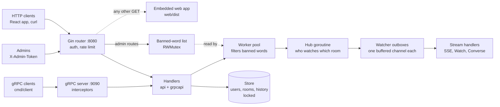

# chatserver

A multi-room chat server written in Go. Messages are pushed live to everyone watching a room, over HTTP or gRPC, and banned words are filtered out as they go. A React chat app is built into the server, so it all runs as **one Go program**, in memory, with no database or other services.

<!-- Add a screenshot of two browser windows chatting here, e.g.:
 -->

## Features

- **Chat in the browser**: a React app, embedded in the server with `go:embed`
- **REST API** with [Gin](https://github.com/gin-gonic/gin), speaking **JSON or protobuf** depending on the request headers
- **gRPC API** using all four kinds of call: unary, server streaming, client streaming and bidirectional
- **Live feed** over Server-Sent Events or gRPC streams
- **Moderation**: worker goroutines replace messages containing [banned words](banned_words.txt) with `[removed]`, and admins can change the list while the server runs
- **Safe under concurrency**, verified with Go's race detector, with **graceful shutdown**
- **Built-in profiling** with `pprof`, a **load tester** and **benchmarks**

## Architecture



A posted message is saved to the room's history, filtered by the worker pool, then handed to the **hub**: a single goroutine that owns the list of watchers and copies the message to each one's outbox. A watcher that falls too far behind is dropped, so one slow client can't hold up a room.

## Quick start

Requires **Go** (the version in `go.mod` or newer).

```bash
git clone https://github.com/Bazelle6726/chatserver.git
cd chatserver
go run ./cmd/server
```

Open **http://localhost:8080/** in two windows, a normal one and a private one, so each has its own sign-in:

1. **Window 1:** create the user `alice`, then add a room `general`.
2. **Window 2:** create `bob`, then click `general`.
3. **Chat:** messages appear instantly in both. "cheap scam here" shows as *[removed]*, but "scampi" doesn't.

To use the **admin API** and the app's Moderation panel, set a secret token before starting the server:

```powershell
$env:CHAT_ADMIN_TOKEN = "pick-a-long-secret"   # PowerShell
go run ./cmd/server
```

| Port | What |
|---|---|
| `8080` | the web app, the HTTP API and the SSE live feed |
| `9090` | the gRPC API |
| `6060` | `pprof` profiling (localhost only) |

## Results

Measured on one laptop (Intel Core i5-1335U). Details in [docs/PERFORMANCE.md](docs/PERFORMANCE.md).

| What | Result |
|---|---|
| 100-message history, protobuf vs JSON | 52% of the size, about 2.7× faster to encode |
| Load test, 500 watchers | ~1,000 posts/s, p99 15.65 ms, 100% delivered |
| Room history as a ring buffer | adding a message 48× faster at 1,000 messages |
| CPU profile under load | ~30% network writes, ~28% garbage collection, chat logic a few % |

## Tests

```bash
go test -race ./...
```

On Windows, `-race` needs gcc; see [docs/DEVELOPMENT.md](docs/DEVELOPMENT.md).

## Project layout

```
chatserver/
├── banned_words.txt   the moderation list
├── cmd/
│   ├── server/        the chat server
│   ├── client/        a gRPC client for the terminal
│   ├── protohttp/     a demo of protobuf over plain HTTP
│   └── loadtest/      the load tester
├── web/               the React app; dist/ is the built app, embedded by embed.go
└── internal/
    ├── chat/          the domain: users, rooms, messages, validation, errors
    ├── store/         the Store interface and in-memory implementation
    ├── api/           the HTTP API: routes, middleware, SSE, admin, web app
    ├── grpcapi/       the gRPC server
    ├── pb/            chat.proto and the generated code
    ├── pbconv/        domain types to protobuf
    ├── moderation/    the banned-word list
    └── hub/           live delivery: the hub and the worker pool
```

## Documentation

- [API reference](docs/API.md): HTTP, live feed, admin, gRPC and protobuf over HTTP
- [Performance](docs/PERFORMANCE.md): benchmarks, load testing and profiling
- [Development](docs/DEVELOPMENT.md): testing, regenerating the protobuf code, and changing the React app
