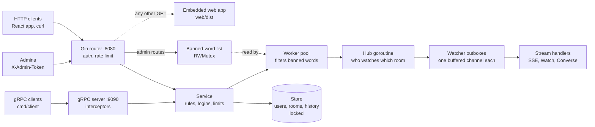

# chatserver

A multi-room chat server written in Go. Messages are pushed live to everyone watching a room, over HTTP or gRPC, and banned words are filtered out as they go. A React chat app is built into the server, so it all runs as **one Go program**, in memory, with no database or other services.

<!-- Add a screenshot of two browser windows chatting here, e.g.:
 -->

## Features

- **Chat in the browser**: a React app, embedded in the server with `go:embed`
- **REST API** with [Gin](https://github.com/gin-gonic/gin), speaking **JSON or protobuf** depending on the request headers
- **gRPC API** using all four kinds of call: unary, server streaming, client streaming and bidirectional
- **Live feed** over Server-Sent Events or gRPC streams
- **In-game chat for Unity**: a WebSocket endpoint, a game API so a game's backend can sign players in and make private match rooms, and a [Unity package](unity/com.chatserver.chat/README.md) with a ready-made chat box
- **Accounts** with bcrypt-hashed passwords and random session tokens: an HttpOnly cookie in the browser, a Bearer token for everything else
- **Rate limits** per user, per IP and per posted message, the same over HTTP and gRPC
- **Moderation**: worker goroutines replace messages containing banned words with `[removed]`. Each server keeps its own list in `banned_words.txt` (never committed), which admins fill in and change while it runs
- **Safe under concurrency**, verified with Go's race detector, with **graceful shutdown**
- **Built-in profiling** with `pprof`, a **load tester** and **benchmarks**
- **Structured logs** with `log/slog` (text or JSON), and every setting as a flag or `CHAT_*` environment variable

## Architecture



Both front doors are thin: they translate requests into calls on one shared **service**, which holds every rule (limits, membership, moderation, logins). A posted message is saved to the room's history, filtered by the worker pool, then handed to the **hub**: a single goroutine that owns the list of watchers and copies the message to each one's outbox. A watcher that falls too far behind is dropped, so one slow client can't hold up a room.

## Quick start

Requires **Go** (the version in `go.mod` or newer).

```bash
git clone https://github.com/Bazelle6726/chatserver.git
cd chatserver
go run ./cmd/server
```

Open **http://localhost:8080/** in two windows, a normal one and a private one, so each has its own sign-in:

1. **Window 1:** type the name `alice` and a password of 8 or more characters, click **Create account**, then add a room `general`.
2. **Window 2:** create `bob` the same way, then click `general`.
3. **Chat:** messages appear instantly in both.

The banned-word list starts empty: the server creates a blank `banned_words.txt` on first start. Add one word per line to it (then restart), or use the admin API below while it runs. With `scam` banned, "cheap scam here" shows as *[removed]*, but "scampi" doesn't.

To use the **admin API** and the app's Moderation panel, set a secret token of at least 16 characters before starting the server:

```powershell
$env:CHAT_ADMIN_TOKEN = "pick-a-long-secret"   # PowerShell
go run ./cmd/server
```

| Port | What |
|---|---|
| `8080` | the web app, the HTTP API and the SSE live feed |
| `9090` | the gRPC API |
| `6060` | `pprof` profiling |

All three listen on `localhost` only by default, so other machines can't reach them until you say so (see below).

## Configuration

Every setting is a flag, with a `CHAT_*` environment variable as a fallback; a flag wins over the variable, which wins over the default. `go run ./cmd/server -h` lists them all.

| Flag | Environment | Default | What |
|---|---|---|---|
| `-http-addr` | `CHAT_HTTP_ADDR` | `localhost:8080` | web app and HTTP API; `:8080` also accepts other machines |
| `-grpc-addr` | `CHAT_GRPC_ADDR` | `localhost:9090` | gRPC API |
| `-pprof-addr` | `CHAT_PPROF_ADDR` | `localhost:6060` | profiling; `""` turns it off. Keep it on localhost |
| `-banned-words` | `CHAT_BANNED_WORDS` | `banned_words.txt` | the moderation list |
| `-requests-per-second` | `CHAT_REQUESTS_PER_SECOND` | `20` | per logged-in user; `0` = no limit |
| `-posts-per-second` | `CHAT_POSTS_PER_SECOND` | `20` | messages per user; `0` = no limit |
| `-signups-per-minute` | `CHAT_SIGNUPS_PER_MINUTE` | `10` | new accounts per IP; `0` = no limit |
| `-logins-per-minute` | `CHAT_LOGINS_PER_MINUTE` | `10` | login attempts per IP; `0` = no limit |
| `-log-format` | `CHAT_LOG_FORMAT` | `text` | `text`, or `json` for a log collector |
| `-log-level` | `CHAT_LOG_LEVEL` | `info` | `debug`, `info`, `warn` or `error` |
| – | `CHAT_ADMIN_TOKEN` | – | turns the admin API on; at least 16 characters. Environment only, since flags are visible to every user on the machine |
| – | `CHAT_GAME_KEY` | – | turns the [game API](docs/API.md#game-api) on, for a game backend to sign players in; at least 16 characters. Environment only |

Logs are structured with `log/slog`: one line per HTTP request or gRPC call, with the route (never the query string), status, time taken, IP and user ID.

```
time=... level=INFO msg="http request" method=GET route=/rooms/:id/messages status=200 ms=0.4 ip=127.0.0.1 user=u-9a371b61666c2e52
```

## Results

Measured on one laptop (Intel Core i5-1335U). Details in [docs/PERFORMANCE.md](docs/PERFORMANCE.md).

| What | Result |
|---|---|
| 100-message history, protobuf vs JSON | 52% of the size, about 2.7× faster to encode |
| Load test, 500 watchers | ~1,000 posts/s, p99 15.65 ms, 100% delivered |
| Room history as a ring buffer | adding a message 48× faster at 1,000 messages |
| CPU profile under load | ~30% network writes, ~28% garbage collection, chat logic a few % |

## Tests

```bash
go test -race ./...
```

On Windows, `-race` needs gcc; see [docs/DEVELOPMENT.md](docs/DEVELOPMENT.md).

## Project layout

```
chatserver/
├── banned_words.txt   the moderation list: made blank on first start, never committed
├── cmd/
│   ├── server/        the chat server
│   ├── client/        a gRPC client for the terminal
│   ├── protohttp/     a demo of protobuf over plain HTTP
│   └── loadtest/      the load tester
├── web/               the React app; dist/ is the built app, embedded by embed.go
├── unity/             the Unity package: in-game chat client and chat box
└── internal/
    ├── chat/          the domain: users, rooms, messages, validation, errors
    ├── store/         the Store interface and in-memory implementation
    ├── service/       the rules both APIs share: rooms, messages, logins, limits
    ├── config/        the server's settings: flags and CHAT_* environment variables
    ├── auth/          password hashing and sessions
    ├── ratelimit/     token-bucket rate limits per user or IP
    ├── api/           the HTTP API: routes, middleware, SSE, admin, web app
    ├── grpcapi/       the gRPC server
    ├── pb/            chat.proto and the generated code
    ├── pbconv/        domain types to protobuf
    ├── moderation/    the banned-word list
    ├── textnorm/      folds look-alike text, for moderation and unique names
    └── hub/           live delivery: the hub and the worker pool
```

## Documentation

- [API reference](docs/API.md): HTTP, live feed, WebSocket, game API, admin, gRPC and protobuf over HTTP
- [Unity package](unity/com.chatserver.chat/README.md): adding in-game chat to a Unity game
- [Performance](docs/PERFORMANCE.md): benchmarks, load testing and profiling
- [Development](docs/DEVELOPMENT.md): testing, regenerating the protobuf code, and changing the React app
